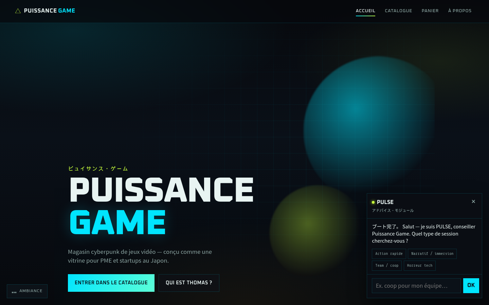
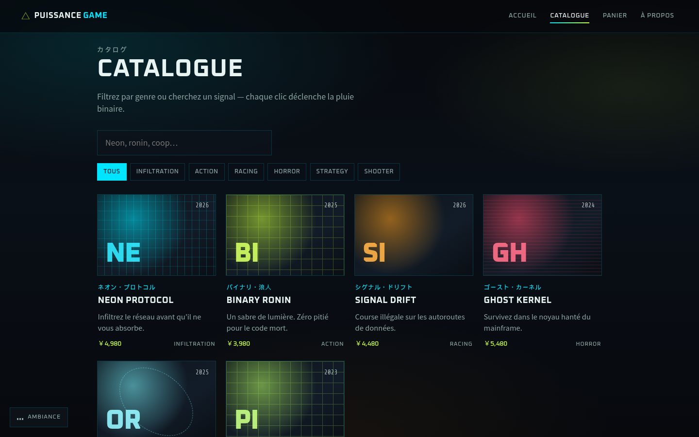
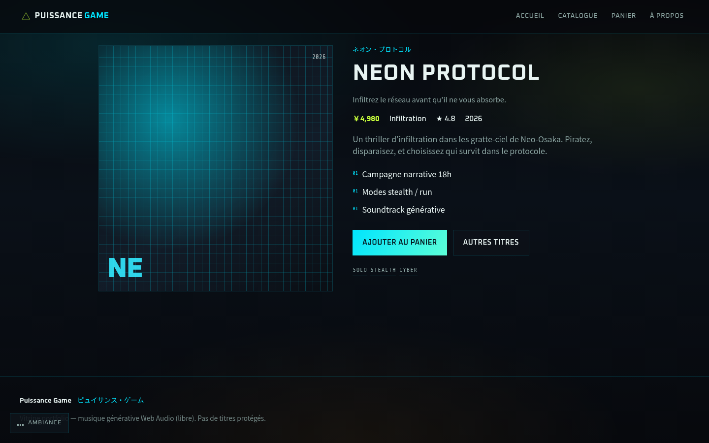
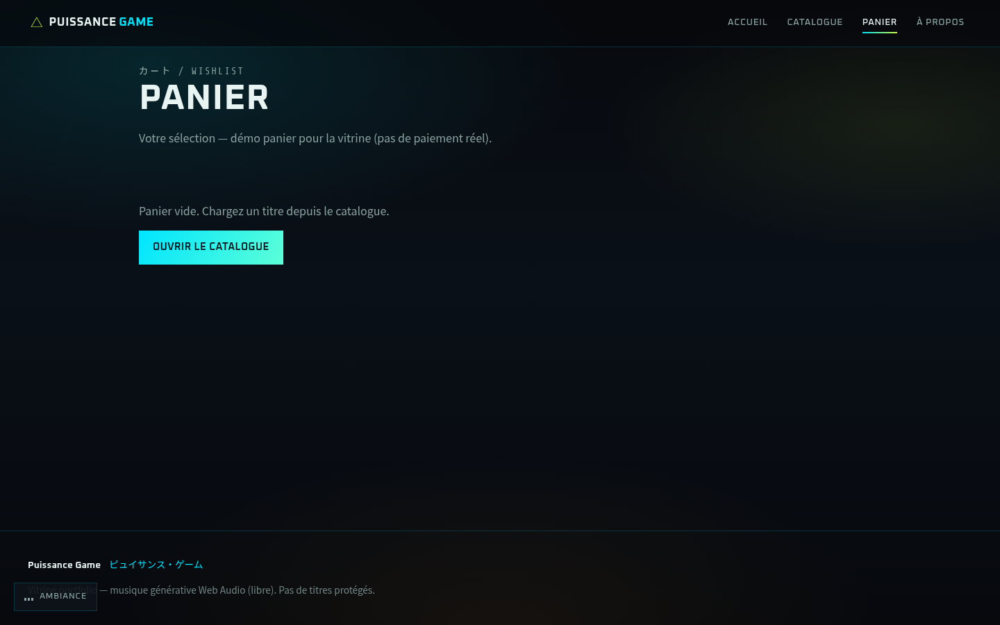
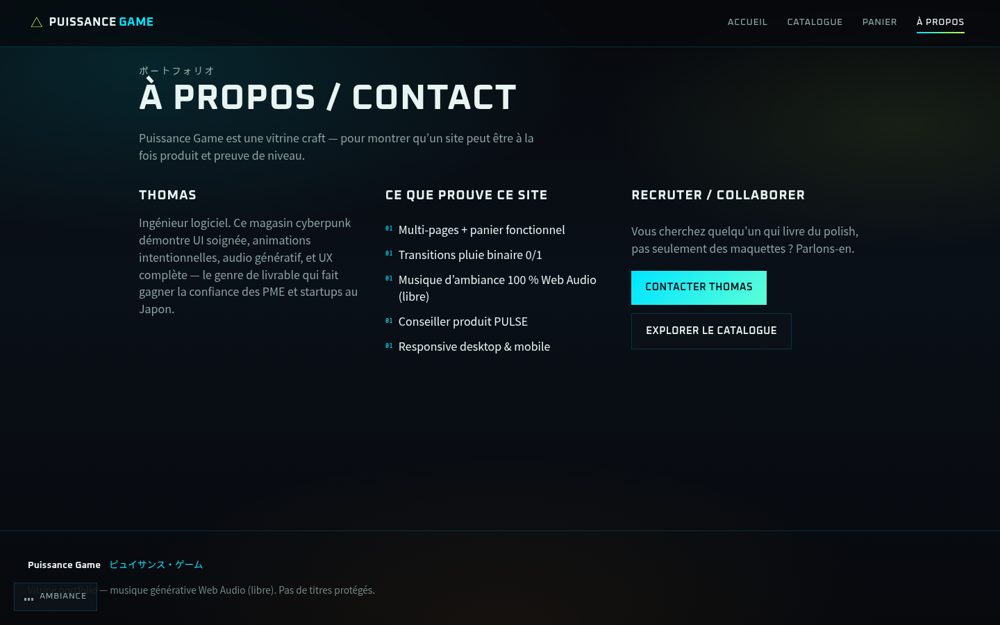
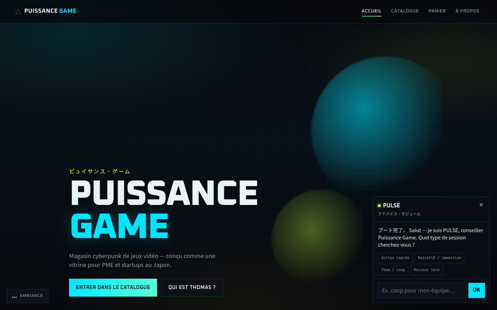

# Thomas — Portfolio développeur

Ingénieur logiciel. Je conçois des interfaces soignées, des apps web modernes, et des expériences qui se remarquent — pour les PME et startups (dont le Japon).

## Projet phare : Puissance Game

Magasin de jeux vidéo **cyberpunk** multi-pages — vitrine technique et visuelle.

**Démo live (bêta) :** [https://rainbow-flare-e78asgg.shipstatic.com](https://rainbow-flare-e78asgg.shipstatic.com)

**Portfolio + captures (GitHub Pages) :** [https://thomasbuot940-alt.github.io/skills-copilot-codespaces-vscode/](https://thomasbuot940-alt.github.io/skills-copilot-codespaces-vscode/)

| Accueil | Catalogue |
| --- | --- |
|  |  |

| Fiche produit | Panier |
| --- | --- |
|  |  |

| À propos | Chatbot PULSE |
| --- | --- |
|  |  |

### Ce que montre ce projet
- Multi-pages React (catalogue, fiche, panier, contact)
- Transitions « pluie binaire » 0/1
- Ambiance sonore **générative** (Web Audio, libre de droits)
- Conseiller produit (chatbot PULSE)
- UI responsive, direction visuelle assumée

### Lancer en local
```bash
cd puissance-game
npm install
npm run dev
```

Code source : [`puissance-game/`](puissance-game/) · PR : [#1](https://github.com/thomasbuot940-alt/skills-copilot-codespaces-vscode/pull/1)

## Compétences
- **Front-end :** React, TypeScript, Vite, CSS moderne, animations, UX
- **Produit :** sites vitrine, e‑commerce démo, storytelling de marque
- **Qualité :** responsive, accessibilité de base, déploiements statiques
- **Audio / interaction :** Web Audio, widgets conversationnels

## Contact
Ouvert aux missions et CDI avec des PME / startups qui veulent du craft, pas seulement des maquettes.

→ Voir aussi la page [À propos](https://rainbow-flare-e78asgg.shipstatic.com/a-propos) sur la démo live.
