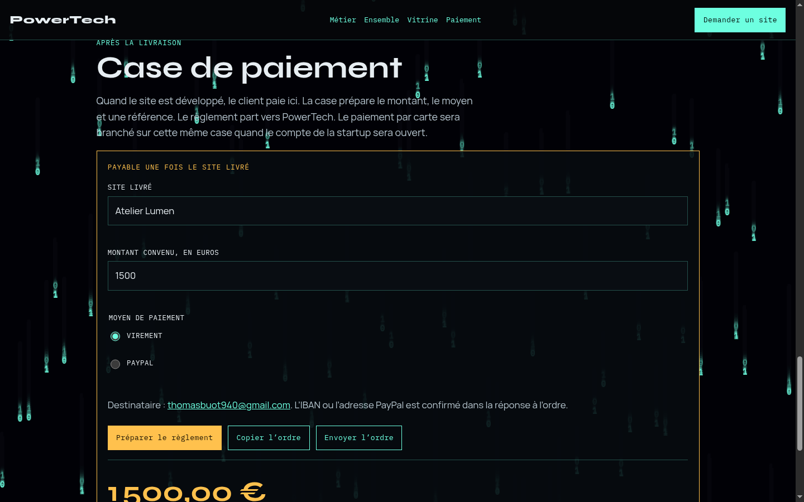

# Thomas — PowerTech

> PowerTech crée des sites web en les générant par intelligence artificielle.

Chez PowerTech, je crée des sites web en les générant par intelligence artificielle.

## Projet phare : PowerTech

Vitrine de l’entreprise. Le texte vend le métier. Les sites livrés se partagent
dans la page. La case de paiement prépare le règlement à la livraison.
L’effet visuel est une pluie de 0 et de 1.

**Code :** [`powertech/`](powertech/)

| Accueil | Case de paiement |
| --- | --- |
|  |  |

| Mobile |
| --- |
|  |

### Lancer en local

```bash
cd powertech
python3 -m http.server 8765
```

Puis ouvrir `http://127.0.0.1:8765`.

Le brief est copié, puis la messagerie s’ouvre vers l’adresse définie
dans `CONTACT_EMAIL`, au début de `powertech/main.js`.

## Projet précédent : Puissance Game

Magasin de jeux vidéo **cyberpunk** multi-pages — vitrine technique et visuelle.

**Démo live (bêta) :** [https://rainbow-flare-e78asgg.shipstatic.com](https://rainbow-flare-e78asgg.shipstatic.com)

**Portfolio + captures (GitHub Pages) :** [https://thomasbuot940-alt.github.io/skills-copilot-codespaces-vscode/](https://thomasbuot940-alt.github.io/skills-copilot-codespaces-vscode/)

| Accueil | Catalogue |
| --- | --- |
|  |  |

| Fiche produit | Panier |
| --- | --- |
|  |  |

| À propos | Chatbot PULSE |
| --- | --- |
|  |  |

### Ce que montre ce projet

- Multi-pages React (catalogue, fiche, panier, contact)
- Transitions « pluie binaire » 0/1
- Ambiance sonore **générative** (Web Audio, libre de droits)
- Conseiller produit (chatbot PULSE)
- UI responsive, direction visuelle assumée

### Lancer Puissance Game

```bash
cd puissance-game
npm install
npm run dev
```

Code source : [`puissance-game/`](puissance-game/) · PR : [#1](https://github.com/thomasbuot940-alt/skills-copilot-codespaces-vscode/pull/1)

## Compétences

- **Front-end :** React, TypeScript, Vite, CSS moderne, animations, UX
- **Produit :** sites vitrine, e‑commerce démo, storytelling de marque
- **Qualité :** responsive, accessibilité de base, déploiements statiques
- **Audio / interaction :** Web Audio, widgets conversationnels

## Contact

Ouvert aux missions et CDI avec des PME / startups qui veulent du craft,
pas seulement des maquettes.

→ Voir aussi la page [À propos](https://rainbow-flare-e78asgg.shipstatic.com/a-propos)
sur la démo live.
